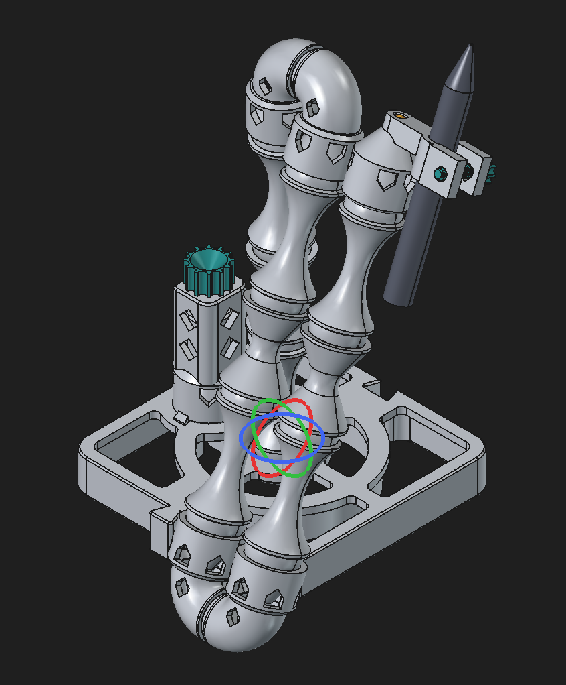

# Scope probe arm

A 3D-printable stand for an oscilloscope probe. **One tensioned wire runs through the centre of every ball joint.** Pulled tight, the wire presses each ball into its conical seat and the friction locks the whole arm at once; slacken the wire and every joint moves freely. No screws, bearings or springs in the joints, only printed parts, one stainless wire and a printed tension screw at the base.

This is the **wire pen repo** (working title: wire pen probe stand): it belongs to the same family as [freecad-jumper-wire-pen](https://github.com/ionutms/freecad-jumper-wire-pen) (a pen that lays jumper wire) and uses the same printed 45-degree thread and the same "one FreeCAD macro makes every part" approach. The pose panel uses the gizmo of [freecad-wire-harness](https://github.com/ionutms/freecad-wire-harness).



> **Status:** not test-printed yet. Everything below was checked in FreeCAD 1.1 on Windows: every part is a valid solid, the neutral pose and the start pose have no overlaps, and the wire channel is clear. The holding margins are calculated, not measured, and in the worst case they are **below 1** (see [Holding margins](#holding-margins-read-this-before-printing)).

## The stand


Default chain (two booms, joints in brackets):

```
base cup -> M0 -> DC -> M1 -> BOOM 1 -> M2 -> DC2 -> M3 -> BOOM 2 -> M4 -> DC3 -> M5 -> probe holder
  [J0a]    [J0b] [J1a] [J1b]   [T1]    [J2a] [J2b] [J2c] [J2d]  [T2]  [J3a] [J3b] [J3c] [J3d]
```

14 joints. J = ball in a cone seat (tilt up to 25 degrees, any direction, plus spin), T = twist of a boom about its rod.

| Part | Count | Printed | What it does |
| --- | --- | --- | --- |
| Base | 1 | yes, upside down | Flat 130 x 130 x 20 mm box, open underneath (pocket for ballast), with the stand cup and the wire guide (a rib, no bearings). |
| Stand end, slider, tension screw | 1 each | yes | The wire is tensioned here: the printed screw pulls the slider, the wire is crimped in a ferrule. |
| M link | 6 | yes | Ball - rod - ball, 55 mm between ball centres by default (36 .. 120 mm), with stop rings that limit the tilt. |
| DC connector | 3 | yes | Two cups back to back, 49 mm between the ball centres. |
| Boom end piece | 4 | yes | The elbow of a boom, hollow with open windows to save material. |
| Boom rod | 2 | yes | Joins the two end pieces of a boom, 3 mm between them, printed with 45-degree cones, no supports. |
| Probe holder, clamp screw | 1 each | yes | A C-clamp for a 13 mm probe body and a printed plastic screw. The wire ends in a ferrule under the cup. |
| Wire | about 860 mm | no | 2.5 mm stainless wire or string, plus two crimp ferrules. 400 N at the knob at full size. |
| Ballast | - | no | Steel shot or similar in the pocket under the base (see the limits below). |

Printed weight with the default settings: **398.5 g** of PETG at 100 % fill (about 307 g with one boom).


## Install and run

1. Install [FreeCAD](https://www.freecad.org/) (1.1 was used).
2. Copy `ProbeStand_OneBoom_Combined.FCMacro` into your FreeCAD macro folder (**Macro > Macros...** shows it).
3. For the rotation gizmo, copy `wire_harness.py` from [freecad-wire-harness](https://github.com/ionutms/freecad-wire-harness) into the same folder. Without it the panel still works, only the gizmo is missing.
4. **Macro > Macros...**, pick `ProbeStand_OneBoom_Combined`, **Execute**.

The first run takes about 30 s, later runs about 7 s: the slow parts (the threads, the base, the holder) are cached in the temporary folder `ProbeStandCache`, keyed by the text of the macro. The macro builds the model, prints a report (volumes, masses, wire length, holding margins) and opens the **Probe stand** panel.

## Posing the stand

- Pick a joint in the list (or click a part), then drag a ring of the gizmo. Every move is checked for new collisions and stops at the last clear angle.
- **Reset joint** and **Reset all** go back to the neutral (stretched) pose. The stand starts in `START_POSE` (the pose in the first picture).
- **M length** + **Rebuild** changes the length of all M links (36 .. 120 mm). The pose is kept if it is still free of collisions.

## Settings

All settings are plain variables at the top of the macro.

| Setting | Default | Meaning |
| --- | --- | --- |
| `BALL_D` | 26 | Ball diameter of the finished model; everything scales with it (8 = a miniature). |
| `NBOOM` | 2 | Number of booms (1 .. 3). 1 gives the one-boom stand (307 g). |
| `ARM_LINKS` | 2 | What joins two booms: 2 = an M - DC - M stack, 0 = one loose ball. |
| `ELBOW_ANG`, `TIP_ANG` | (90, 0), 90 | Direction in which the stack after a boom points (90 = sideways to -y, 270 = +y, 0 = up). |
| `TIP_LINKS` | 2 | Tip side: 2 = M - DC - M, 1 = a single M link. |
| `M_LEN` | 55 | Ball centre distance of the M links, mm. |
| `WIRE_THICK`, `WIRE_T` | 2.5, 400 | Wire diameter (mm) and tension (N, full size). |
| `START_POSE` | T1 68.125, T2 180 | Pose at start; `{}` = all joints neutral. |
| `OPEN_PANEL`, `RUN_CHECKS` | True, True | Open the panel; print the report and holding margins. |

`export_stl("folder")` writes one STL per printed part (end pieces and rods once, with the count in the file name).

## Printing

- No supports are needed by design: all slopes are at most 45 degrees from vertical (cones, teardrop holes, hexagonal windows with a 45-degree roof). The base prints upside down, the rod standing on a spigot, the end pieces and the holder with the cup up. Overhang was measured on the tessellated parts, not tested on a printer.
- The threads (screw, slider, clamp screw) are the 45-degree FDM thread of the jumper wire pen: coarse pitch, flat crest and root.
- PETG was assumed for the masses (1.27 g/cm3).

## Holding margins (read this before printing)

The macro computes, for every joint, the holding torque of the wire friction against the torque of a 100 g test weight at the probe plus the weight of everything beyond the joint, over 4000 random poses with every ball tilted up to its limit. A margin below 1 means that in the worst of those poses the joint may slip. With the default two-boom stand:

| Joint | J0a | J0b | J1a | J1b | J2a | J2b | J2c | J2d | J3a | J3b | J3c | J3d |
| --- | --- | --- | --- | --- | --- | --- | --- | --- | --- | --- | --- | --- |
| Margin | 0.43 | 0.46 | 0.50 | 0.54 | 0.29 | 0.34 | 0.39 | 0.48 | 0.32 | 0.44 | 0.65 | 1.30 |

With one boom the worst joint (J2a) is 0.71. Each boom costs about half of the wire tension (0.456: the wire rubs in the two bends of the end pieces) and the 100 g sits 492 mm from the mast instead of 267 mm. What helps: less friction in the bends (a PTFE tube or a lubricated wire, `MU_W` 0.10 gives 0.73 per boom), TPU seats, a lighter probe, shorter M links, or a folded pose. Real-world numbers need a print test.

## Known limits

- Not printed or tested with a real probe.
- Ballast: the 0.4 kg named in the macro for one boom is too little for the stretched two-boom stand; a rough, unverified estimate is 1.5 .. 2 kg (or clamp the base). The folded start pose needs far less.
- At the two ends of every boom rod the wire edge touches the rod stub in the bend (8 of 3245 sample points per rod in the wire check, about 0.5 mm); a flexible wire should follow the bend, but a stiff one may rub.
- The miniature (`BALL_D = 8`) was not rechecked after the second arm and the hollow end pieces (the hollow end pieces switch themselves off when the wire channel gets too wide).
- The collision test uses boolean operations of FreeCAD. They are slow in some blocked poses, and the pairs of one boom (end pieces and rod) are not tested at all because that test froze FreeCAD at some twist angles.

## Files

| File | |
| --- | --- |
| `ProbeStand_OneBoom_Combined.FCMacro` | The whole project: parameters, every part, wire path, pose panel, collision test, holding margins, STL export. The header of the file documents every design decision. |
| `images/` | Pictures used in this README. |

## License

MIT, see `LICENSE`.
