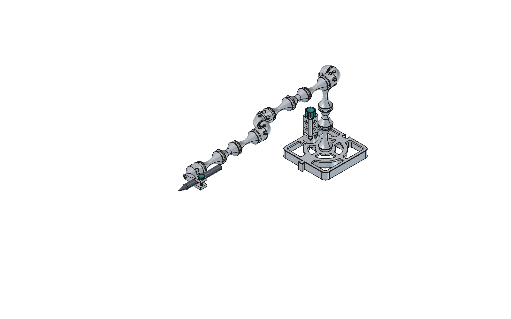
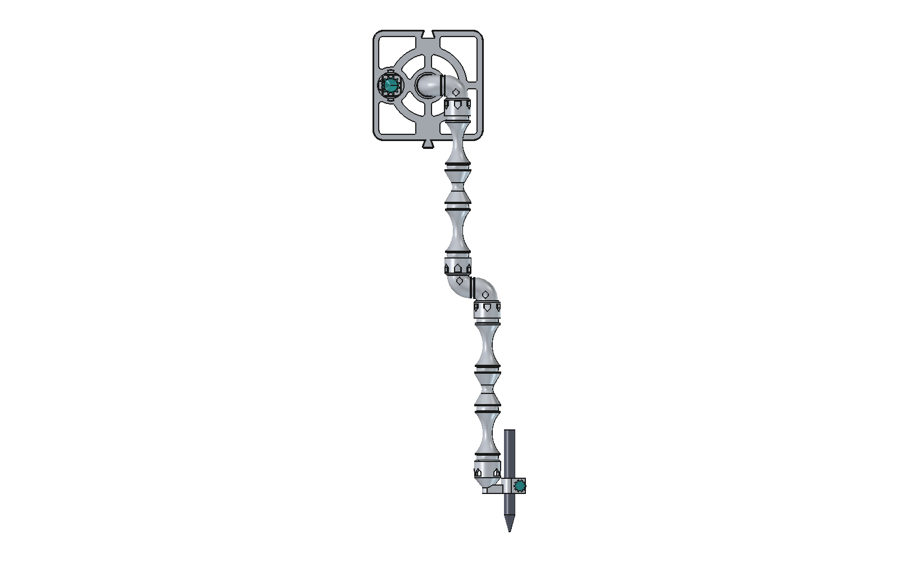
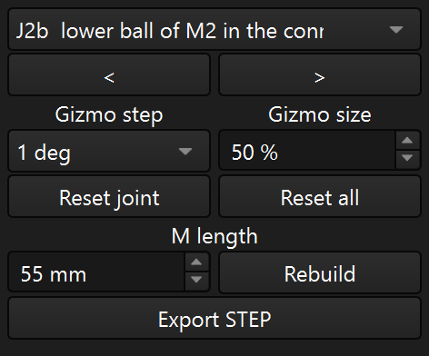
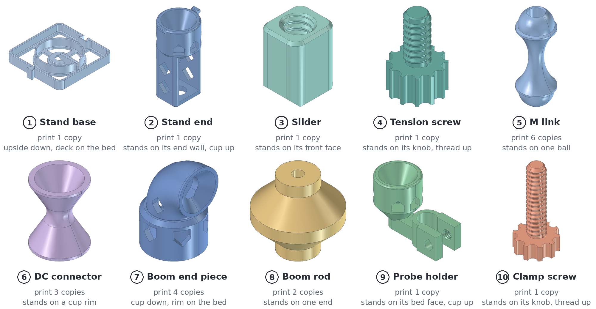

# Scope probe arm

A 3D-printable articulated arm that holds an oscilloscope probe. **One tensioned wire runs through the centre of every ball joint.** Pulled tight, the wire presses each ball into its conical seat and the friction locks the whole arm at once; slacken the wire and every joint moves freely. There are no screws, bearings or springs in the joints: only printed parts, one wire, and a printed screw at the base that tensions it.

This is the **wire pen repo** (working title: wire pen probe stand). Like [freecad-jumper-wire-pen](https://github.com/ionutms/freecad-jumper-wire-pen) it is **one FreeCAD macro that makes every printed part**, designed for FDM printing. The pose panel uses the rotation gizmo of [freecad-wire-harness](https://github.com/ionutms/freecad-wire-harness).


> **Status:** not test-printed yet. In FreeCAD 1.1 on Windows every part is a valid single solid, the neutral pose and the start pose have no overlaps, and the wire path is clear of the material. The holding margins are calculated, not measured, and in the worst case they are **below 1** (see [Holding margins](#holding-margins-read-this-before-printing)).

## The parts

Default chain, two booms (joint names in brackets):

```
base cup -> M0 -> DC -> M1 -> BOOM 1 -> M2 -> DC2 -> M3 -> BOOM 2 -> M4 -> DC3 -> M5 -> probe holder
  [J0a]    [J0b] [J1a] [J1b]   [T1]    [J2a] [J2b] [J2c] [J2d]  [T2]  [J3a] [J3b] [J3c] [J3d]
```

14 joints. A **J** joint is a ball in a cone seat (tilt up to 25 degrees in any direction, plus spin). A **T** joint is the twist of a boom about its rod. Stretched out (the picture below), the probe holder is about 490 mm from the mast; folded (the picture above) the arm stands next to the base.



| # | Part | Printed or bought | How many | Each | What it does |
| --- | --- | --- | --- | --- | --- |
| 1 | Stand base | printed | 1 | 109.6 g | Flat square deck, 130 mm wide and 20 mm high, open underneath: the pocket (about 170 cm3) takes the ballast. It holds the stand cup (the first ball seat) and guides the wire round two fixed rounded drums between lugs, with no bearings. |
| 2 | Stand end | printed | 1 | 21.6 g | The tensioner at the base. It stands on the deck, with two ears in two slots, and carries the slider and the screw. |
| 3 | Slider | printed | 1 | 6.1 g | Holds the crimp ferrule at the end of the wire and runs in the stand end. |
| 4 | Tension screw | printed | 1 | 5.6 g | Printed thread with a knob. Turning it pulls the slider and tensions the wire (400 N at full size). |
| 5 | M link | printed | 6 | 18.1 g | Ball - rod - ball, 55 mm between the ball centres by default (36 .. 120 mm), with stop rings that limit the tilt. |
| 6 | DC connector | printed | 3 | 10.9 g | Two cups back to back, 49 mm between the ball centres. |
| 7 | Boom end piece | printed | 4 | 19.8 g | The elbow of a boom: a cup block and a bend for the wire, hollow, with open windows. |
| 8 | Boom rod | printed | 2 | 4.5 g | Joins the two end pieces of a boom; a boom is 35 mm from cup centre to cup centre. |
| 9 | Probe holder | printed | 1 | 24.6 g | The last cup, with a pocket for the wire ferrule and a C-clamp for a 13 mm probe body. |
| 10 | Clamp screw | printed | 1 | 1.5 g | Printed screw that closes the clamp by hand. |
| 11 | Wire | bought | about 860 mm | | 2.5 mm wire or Dyneema string. It runs through every part. |
| 12 | Crimp ferrule | bought | 2 | | 4.5 x 5 mm: one at the slider, one in the probe holder. |
| 13 | Ballast | bought | | | For the pocket under the base (see [Known limits](#known-limits)). |

Total printed weight with the default settings: **398.5 g** (PETG, 100 % fill). The numbers 1 to 10 are the same in the pictures of the [Printing](#printing) section.



## Install and run

1. Install [FreeCAD](https://www.freecad.org/) (1.1 was used).
2. Copy `ProbeStand_OneBoom_Combined.FCMacro` into your FreeCAD macro folder (**Macro > Macros...** shows it).
3. Copy `wire_harness.py` from [freecad-wire-harness](https://github.com/ionutms/freecad-wire-harness) into the same folder. It draws the rotation gizmo. Without it the panel still opens, but the pose can then only be set from the Python console (`CTRL.set_value`).
4. **Macro > Macros...**, pick `ProbeStand_OneBoom_Combined`, **Execute**.

The first run takes about 25 to 30 seconds. The slow parts (the threaded parts, the base, the holder) are cached in the temporary folder `ProbeStandCache`, keyed by the text of the macro, so later runs take a few seconds. The macro builds the model, prints a report (volumes, masses, wire length, holding margins) in the Report view, and opens the **Probe stand** panel.

Running the macro again builds a new document and replaces the panel; the old model document stays open.

## The panel



The **Probe stand** panel docks next to the 3D view. It is not modal: it stays open while you work.

| Control | What it does |
| --- | --- |
| Joint list | One entry per joint (see the table below). The panel opens with **J1b**, the elbow, selected. |
| `<` and `>` | Select the previous or the next joint. |
| Gizmo step | The angle of one arrow-key step, and the snap of a ring drag: 0.1, 0.5, 1, 5, 15 or 45 degrees. |
| Gizmo size | Size of the gizmo in the 3D view, 50 to 300 %. |
| Reset joint | Back to neutral for the selected joint. |
| Reset all | Back to the neutral (stretched) pose. The arm starts in `START_POSE`, the folded pose in the first picture. |
| M length + Rebuild | Changes the length of all M links (36 .. 120 mm) and rebuilds the model (about 20 seconds). The pose is kept if it is still free of collisions. |
| Export STEP | Asks for a folder and writes one STEP file per printed part into it, turned the way it is printed (see [STEP files](#step-files)). The files do not depend on the pose. |

**Posing.** Pick a joint in the list or click a part in the 3D view, then drag a ring of the gizmo. The gizmo sits on the selected joint: the red and green rings tilt the joint about its two ring axes, the blue ring spins it about the cup axis, and a **T** joint has one ring that twists the boom about its rod. Hold **Shift** for fine steps, press the **arrow keys** for one step of the gizmo step size, press **Esc** to cancel a drag. The status bar and the Report view show the pose of the selected joint, for example `J2b: tilt 12.0 deg toward 90 deg, spin 0.0 deg` (the tilt, the direction it tilts toward, and the spin).

**Collisions.** Every move is checked against the other parts. A turn that would create a new overlap stops at the last clear angle and the status bar says why (`J2b not changed: ...`). Overlaps that already exist in a pose are listed with their volume.

| Joint | Where it is |
| --- | --- |
| J0a | stand cup, lower ball of M0 |
| J0b | top ball of M0 in the connector DC |
| J1a | lower ball of M1 in the connector DC |
| J1b | top ball of M1 (the cup of boom 1) |
| T1 | boom 1 twist about its rod |
| J2a | upper ball of M2 in the end cup of boom 1 |
| J2b | lower ball of M2 in the connector DC2 |
| J2c | upper ball of M3 in the connector DC2 |
| J2d | lower ball of M3 in the near cup of boom 2 |
| T2 | boom 2 twist about its rod |
| J3a | upper ball of M4 in the end cup of boom 2 |
| J3b | lower ball of M4 in the connector DC3 |
| J3c | upper ball of M5 in the connector DC3 |
| J3d | lower ball of M5 in the cup of the probe holder |

## Settings

All settings are plain variables at the top of the macro.

| Setting | Default | Meaning |
| --- | --- | --- |
| `BALL_D` | 26 | Ball diameter of the finished model; everything scales with it (8 = a miniature, not rechecked). |
| `NBOOM` | 2 | Number of booms (1 .. 3). |
| `ARM_LINKS` | 2 | What joins one boom to the next: 2 = an M - DC - M stack, 0 = one loose ball. |
| `ELBOW_ANG` | (90, 0) | Direction in which the stack after boom 1 and boom 2 points, in degrees about the rod axis (90 = sideways to -y, 270 = +y, 0 = up, 180 = down). |
| `TIP_ANG` | 90 | The same for the tip side after the last boom. `TIP_ANG = ELBOW_ANG[0]` gives the stretched arm, `ELBOW_ANG[0] + 180` folds it back. |
| `TIP_LINKS` | 2 | Tip side: 2 = M - DC - M, 1 = a single M link. |
| `M_LEN` | 55 | Ball-centre distance of the M links, mm. |
| `WIRE_THICK`, `WIRE_T` | 2.5, 400 | Wire diameter (mm) and tension (N, full size). |
| `START_POSE` | T1 68.125, T2 180 | Pose at start; `{}` = all joints neutral. A pose that collides is dropped. |
| `OPEN_PANEL`, `RUN_CHECKS` | True, True | Open the panel; print the report and the holding margins. |

## Printing



The pictures are not to scale. The numbers are the part numbers of the table above. The M link and the DC connector stand on their axis (a ball or a rim on the bed), the end piece stands on the rim of its cup, the rod stands on one end, and the base prints upside down with the deck on the bed.

Print the parts in this number at the default settings: 1 stand base, 1 stand end, 1 slider, 1 tension screw, 6 M links, 3 DC connectors, 4 boom end pieces, 2 boom rods, 1 probe holder, 1 clamp screw. With other settings (`NBOOM`, `TIP_LINKS`) the numbers change; the console prints them when you press **Export STEP**.

The macro is shaped for printing (45-degree cones and fillets, teardrop holes, hexagonal windows with a 45-degree roof), but **not every part is free of overhangs**. This table is measured on the STEP files in the print orientation of the picture: the area of the faces that face down and are more than 46 degrees from vertical, without the face on the bed. "Flat" means part of that area is flat roofs, which print as short bridges.

| # | Part | Stands on | Overhang (mm2) |
| --- | --- | --- | --- |
| 1 | Stand base | the deck (upside down) | 39 (20 flat) |
| 2 | Stand end | its end wall, cup up | 213 (all flat) |
| 3 | Slider | its front face | 2 |
| 4 | Tension screw | its knob, thread up | 0 |
| 5 | M link | one ball | 308 (the lower ball, a sphere) |
| 6 | DC connector | a cup rim | 6 (flat) |
| 7 | Boom end piece | the rim of its cup | 246 (161 flat) |
| 8 | Boom rod | one end | 0 |
| 9 | Probe holder | its bed face, cup up | 25 (18 flat) |
| 10 | Clamp screw | its knob, thread up | 1 |

The M link balls, the end pieces and the stand end are the parts that may need support or a good bridging profile. The M link touches the bed with a single point, so use a brim or supports under its lower ball.

- The slider and the tension screw take the full wire tension (400 N at full size). Print them with many walls and full infill. If a screw breaks, print it lying down with 100 % infill.
- PETG, 0.2 mm layers and 4 walls were assumed for all masses and strength estimates.
- Overhangs were measured on the models, not tested on a printer.

To get files for other settings, change them in the macro, run it and press **Export STEP**.

## STEP files

The `models/` folder has a STEP file for each printed part, made at the default sizes and turned the way the part is printed (see the picture in the Printing section). The files do not include the wire, the ferrules or the stand-in probe.

| File | Part | How many to print | Size when printed (mm) |
| --- | --- | --- | --- |
| `models/stand_base.step` | 1 Stand base | 1 | 130 x 139 x 20 |
| `models/stand_end.step` | 2 Stand end | 1 | 31.2 x 36.2 x 65 |
| `models/slider.step` | 3 Slider | 1 | 16 x 18 x 24 |
| `models/tension_screw.step` | 4 Tension screw | 1 | 21.6 x 21.6 x 33.2 |
| `models/m_link.step` | 5 M link | 6 | 29.5 x 29.5 x 76.8 |
| `models/dc_connector.step` | 6 DC connector | 3 | 31.2 x 31.2 x 40 |
| `models/end_piece.step` | 7 Boom end piece | 4 | 31.6 x 31.2 x 48 |
| `models/rod.step` | 8 Boom rod | 2 | 21 x 21 x 20 |
| `models/probe_holder.step` | 9 Probe holder | 1 | 60.7 x 31.2 x 39.3 |
| `models/clamp_screw.step` | 10 Clamp screw | 1 | 14 x 13.7 x 30 |

Many slicers (PrusaSlicer, for example) open STEP files directly; for other slicers, convert the file to STL. These files only fit the default sizes. For other sizes, run the macro and press **Export STEP**.

To make the files without the panel, run this in the FreeCAD Python console; it builds the model without the panel and writes the folder:

```python
import os
mac = os.path.join(App.getUserMacroDir(True), "ProbeStand_OneBoom_Combined.FCMacro")
src = open(mac, encoding="utf-8").read().replace("OPEN_PANEL = True", "OPEN_PANEL = False").replace("RUN_CHECKS = True", "RUN_CHECKS = False")
ns = {"__name__": "__main__", "__file__": mac}
exec(compile(src, mac, "exec"), ns)
ns["export_step"](r"C:\path\to\models")
```

## Shopping list

- About 860 mm of 2.5 mm wire or Dyneema string. The macro cuts the wire at 858 mm (838 mm of path plus 20 mm for the crimps); the wire can be a little longer for the knob.
- Two crimp ferrules, 4.5 mm outside diameter and 5 mm long (change `WIRE_THICK` if your wire is not 2.5 mm).
- Ballast for the pocket under the base: steel shot set in epoxy, steel discs or lead sheet. See [Known limits](#known-limits) for how much.
- An oscilloscope probe with a 13 mm body (`PROBE_D` in the macro).
- Optional: PTFE tape in the channel of the wire guide in the base, to lower the friction.

## Holding margins (read this before printing)

For every joint the macro compares the holding torque of the wire friction with the load torque: a 100 g probe, 1 N pushes down and sideways at the probe tip, and the weight of everything beyond the joint. It takes 4000 random poses with every ball tilted up to its limit and keeps the worst. A margin below 1 means that in the worst of those poses the joint may slip. With the default two-boom arm:

| Joint | J0a | J0b | J1a | J1b | J2a | J2b | J2c | J2d | J3a | J3b | J3c | J3d |
| --- | --- | --- | --- | --- | --- | --- | --- | --- | --- | --- | --- | --- |
| Margin | 0.48 | 0.52 | 0.57 | 0.64 | 0.34 | 0.40 | 0.48 | 0.60 | 0.45 | 0.65 | 0.98 | 1.60 |

The macro prints this table (with the torques) in the FreeCAD Report view every time it runs.

With one boom the margins were more than twice as good (the worst joint, J2a, was 0.71). Each boom costs about half of the wire tension (0.456: the wire rubs in the two bends of the end pieces), and the load arm of the probe grows from 267 mm to 492 mm. What helps: less friction in the bends (a PTFE tube or a lubricated wire: `MU_W` 0.10 gives 0.73 per boom instead of 0.456), TPU seats, a lighter probe, shorter M links, or a folded pose. The wire friction is an assumption (`MU_W` = 0.25), so real numbers need a print test.

## Known limits

- Not printed and not tested with a real probe.
- Not every part prints without support (see the overhang table in the Printing section).
- Ballast: the 0.4 kg named in the macro was worked out for one boom (100 g at 267 mm). For the stretched two-boom arm (probe at y = -492 mm) a rough estimate is 1.5 to 2 kg, not verified. Clamp the base to the table, or fill the pocket with steel shot in epoxy or steel discs. The folded start pose needs much less.
- At the rod stubs of the booms the wire path comes into the material at 16 of 3245 sample points (8 per rod). A flexible wire follows the bend, but a stiff one may rub there.
- The miniature (`BALL_D = 8`) was not rechecked after the second arm was added. On small models the hollow end pieces switch themselves off, because the wire channel becomes too wide.
- The collision test uses FreeCAD boolean operations and is slow in some blocked poses. The three parts of one boom (two end pieces and the rod) are never tested against each other: they only turn about their common axis, and the boolean operation between them froze FreeCAD at some twist angles.

## Files

| File | What it is |
| --- | --- |
| `ProbeStand_OneBoom_Combined.FCMacro` | The macro: parameters, every part, the wire path, the pose panel, the collision test, the holding margins and the STEP and STL export. The header of the file explains the design decisions. |
| `models/` | STEP files of the ten printed parts at the default sizes. |
| `images/` | The pictures used in this README. |
| `LICENSE` | The MIT license. |

## License

MIT, see `LICENSE`.
